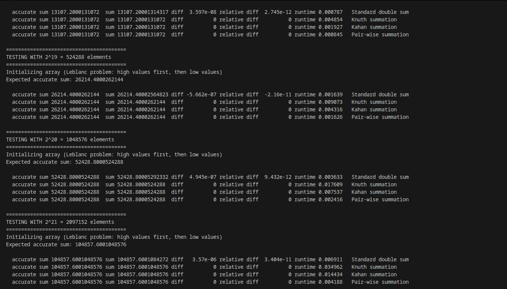

# parallel-programming

## Assignment 4

## Summation
## Algorithms used for summation
- Standard double sum
- Knuth summation
- Kahan summation
- Pair-wise summation
## What does the code do?
- Runs test for different algorithms and for different array sizes
- Can handle errors

## Why is some technique better than the other?
- Standard sum: Computer cannot store decimal numbers precisely and those errors over time can accumulate into a larger difference when there is more numbers
- Kahan and Knuth sum: These algorithms basically do the same thing except they keep track of small errors instead of just letting them go. They use a variable for the part of the number that got lost during rounding
- Pair-wise sum: It tries to keep additions balanced meaning the algorithm adds numbers of similar size first, so that the rounding errors cancel out

## Why does it matter for parallelization?
- Standard sum is fast but it requires a certain order otherwise the result will be different every time
- Kahan/Knuth sum is more accurate than standard but it's sequential meaning parallelization is harder
- Pair-wise sum is very good for parallelization because different threads can compute partial sums at the same time

Google sheets link: https://docs.google.com/spreadsheets/d/1vE_4GxToLfvh0gBTp9HOPO0gVxc5rOaJi5ghXjZkfAU/edit?gid=0#gid=0

